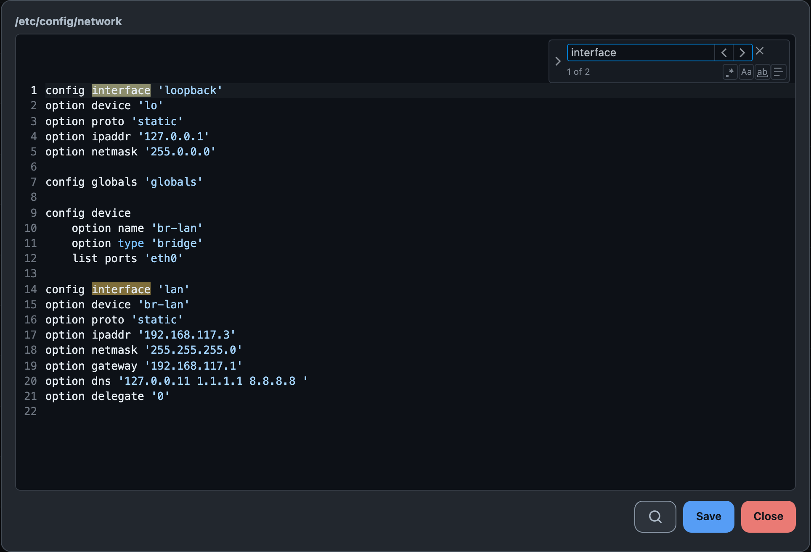

# LUCI-APP-FOOTSTRAP-FILES

**English** · [Русский](README_ru.md)

[](https://owfeed.org/install/)
[](https://owfeed.org/install/)

A file manager page for LuCI on OpenWrt 24.10 and newer. It depends on `luci-base` and `cgi-io`
only, and works under any LuCI theme.

<picture>
  <source media="(prefers-color-scheme: dark)" srcset="assets/readme/tiles-dark.png">
  
</picture>

<details>
<summary>The editor, with find-and-replace open</summary>



</details>

## Install

Add the `owfeed-packages` feed once. The script installs the feed's key, keeps the feed and the key
across a sysupgrade, and updates the package lists:

```sh
wget -qO- https://repo.owfeed.org/subscribe.sh | sh
```

Install the package:

```sh
apk add luci-app-footstrap-files        # 25.12 and newer
opkg install luci-app-footstrap-files   # 24.10
```

Open **System → Files**.

- The feed's key is trusted for every package in the feed.
  [owfeed.org/install](https://owfeed.org/install/) shows the same steps by hand.
- Translations are separate packages: `luci-i18n-footstrap-files-ru`, `-es`, `-zh-cn`. apk installs
  one by itself when the matching `luci-i18n-base-*` is present. With opkg, install it by name:
  `opkg install luci-i18n-footstrap-files-ru`.

Without the feed, download the package from a [release](../../releases/latest) to the router. Each
file has a usign signature beside it (`.sig`). `luci-base` and `cgi-io` must already be installed.

```sh
apk add --allow-untrusted ./luci-app-footstrap-files-0.1.5-r1.apk   # 25.12 and newer
opkg install ./luci-app-footstrap-files_0.1.5-r1_all.ipk            # 24.10
```

## What it does

- **Browse**: breadcrumbs, sortable columns, list or tiles. The path is in the URL.
- **Change**: upload (button or drag and drop), download, rename, copy, move, delete, new file, new
  folder.
- **Permissions**: mode as `644`, owner as `user:group`. Recursive only when the box is ticked.
- **Edit text**: files up to 1 MB (a larger file is refused), highlighting for uci, shell and JSON,
  line numbers, bracket matching, find and replace.
- **Edit bytes**: a file that is not text opens in a hex editor. A save keeps its mode and owner.

It has no markdown preview and no column resizing.

## Keys and gestures

| Action | Mouse and keyboard | Touch |
|---|---|---|
| Open | click, Enter | tap |
| Menu | right click | long press |
| Select several | Ctrl/Cmd+click, Shift+click, Shift+arrows, Space, Ctrl/Cmd+A, drag a rectangle from empty space | menu → **Select**, then tap |
| Move | drag onto a folder | **Move**, open the destination, **Paste here** |
| Find in the editor | Ctrl/Cmd+F | magnifier button |

Escape leaves select mode. A delete and a move by dragging ask first.

## Access

The package runs as **root over the whole filesystem**, the same grant the stock
`luci-app-filemanager` takes:

```json
"file": { "/*": [ "list", "read", "write", "exec" ] }
```

Anyone who can log into LuCI with the `luci-app-footstrap-files` ACL can read and change any file on
the router and run any command as root. No setting narrows it.

- Commands (`mkdir`, `mv`, `cp`, `rm`, `chmod`, `chown`) run with an argument array and `--`, never
  a shell string. A file named `; reboot;` or `-rf` is an argument.
- A file name reaches the page as text. The code has no `innerHTML`, and CI checks it.

## Build

Run from the repository root. `owfeed` comes from [owfeed/owfeed](https://github.com/owfeed/owfeed).

```sh
npm ci
tools/t0.sh                                # parse checks, before and after jsmin
FOOTSTRAP_VERSION=0.1.5 ./tools/stage.sh   # dist/root, minified; set your own version
owfeed build                               # dist/noarch/*.apk and dist/all/*.ipk, translations too
```

The `.apk` is 30 KB. The `Makefile` is an ordinary `luci.mk` package, so an OpenWrt SDK build works
too.

## Licence

Apache-2.0. The editor is [prism-code-editor](https://github.com/jonpyt/prism-code-editor) (MIT),
vendored with its licence under
`luci-app-footstrap-files/htdocs/luci-static/resources/view/footstrap-files/vendor/pce/LICENSE`.
