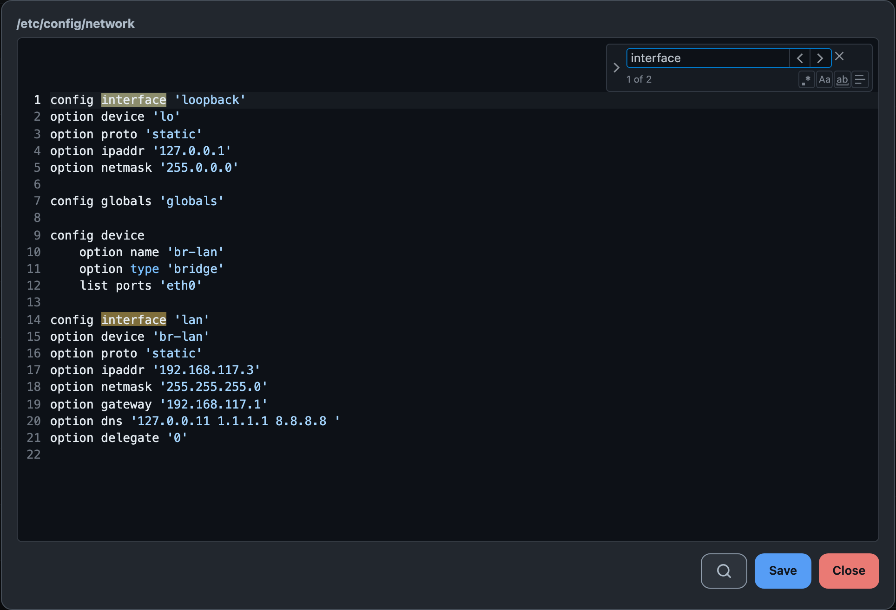

# LUCI-APP-FOOTSTRAP-FILES

[English](README.md) · **Русский**

[](https://owfeed.org/install/ru/)
[](https://owfeed.org/install/ru/)

Файловый менеджер для LuCI на OpenWrt 24.10 и новее. Зависит только от `luci-base` и `cgi-io`,
работает под любой темой LuCI.

<picture>
  <source media="(prefers-color-scheme: dark)" srcset="assets/readme/tiles-dark.png">
  
</picture>

<details>
<summary>Редактор с открытым поиском и заменой</summary>



</details>

## Установка

Один раз добавьте фид `owfeed-packages`. Скрипт ставит ключ фида, сохраняет фид и ключ при
sysupgrade и обновляет списки пакетов:

```sh
wget -qO- https://repo.owfeed.org/subscribe.sh | sh
```

Установите пакет:

```sh
apk add luci-app-footstrap-files        # 25.12 и новее
opkg install luci-app-footstrap-files   # 24.10
```

Откройте **Система → Файлы**.

- Ключ фида означает доверие ко всем пакетам фида.
  На [owfeed.org/install](https://owfeed.org/install/ru/) те же шаги показаны вручную.
- Переводы идут отдельными пакетами: `luci-i18n-footstrap-files-ru`, `-es`, `-zh-cn`. apk ставит
  нужный сам, если на роутере есть соответствующий `luci-i18n-base-*`. В opkg ставьте по имени:
  `opkg install luci-i18n-footstrap-files-ru`.

Без фида скачайте пакет из [релиза](../../releases/latest) на роутер. Рядом с каждым файлом лежит
подпись usign (`.sig`). `luci-base` и `cgi-io` должны быть уже установлены.

```sh
apk add --allow-untrusted ./luci-app-footstrap-files-0.1.5-r1.apk   # 25.12 и новее
opkg install ./luci-app-footstrap-files_0.1.5-r1_all.ipk            # 24.10
```

## Что умеет

- **Смотреть**: хлебные крошки, сортировка по колонкам, список или плитка. Путь хранится в URL.
- **Менять**: загрузка (кнопкой или перетаскиванием), скачивание, переименование, копирование,
  перенос, удаление, новый файл, новая папка.
- **Права**: режим в виде `644`, владелец в виде `user:group`. Рекурсивно только с галочкой.
- **Править текст**: файлы до 1 МБ (файл больше не открывается), подсветка uci, shell и JSON, номера строк, парные скобки, поиск
  и замена.
- **Править байты**: нетекстовый файл открывается в hex-редакторе. Сохранение не меняет режим и
  владельца.

Предпросмотра markdown и изменения ширины колонок нет.

## Клавиши и жесты

| Действие | Мышь и клавиатура | Тач |
|---|---|---|
| Открыть | клик, Enter | тап |
| Меню | правый клик | долгое нажатие |
| Выбрать несколько | Ctrl/Cmd+клик, Shift+клик, Shift+стрелки, пробел, Ctrl/Cmd+A, рамка мышью от пустого места | меню → **Выбрать**, затем тапы |
| Перенести | перетащить на папку | **Переместить**, открыть папку назначения, **Вставить сюда** |
| Поиск в редакторе | Ctrl/Cmd+F | кнопка с лупой |

Escape выходит из режима выбора. Удаление и перенос перетаскиванием спрашивают подтверждение.

## Доступ

Пакет работает от **root над всей файловой системой**, с тем же правом, что и стоковый
`luci-app-filemanager`:

```json
"file": { "/*": [ "list", "read", "write", "exec" ] }
```

Любой, кто входит в LuCI с ACL `luci-app-footstrap-files`, читает и меняет любой файл на роутере и
запускает любую команду от root. Настройки, которая это сужает, нет.

- Команды (`mkdir`, `mv`, `cp`, `rm`, `chmod`, `chown`) запускаются массивом аргументов с `--`,
  никогда строкой для shell. Файл с именем `; reboot;` или `-rf` остаётся аргументом.
- Имя файла попадает на страницу как текст. В коде нет `innerHTML`, и CI это проверяет.

## Сборка

Запускайте из корня репозитория. `owfeed` берётся из [owfeed/owfeed](https://github.com/owfeed/owfeed).

```sh
npm ci
tools/t0.sh                                # проверка разбора, до и после jsmin
FOOTSTRAP_VERSION=0.1.5 ./tools/stage.sh   # dist/root, минифицировано; версию ставьте свою
owfeed build                               # dist/noarch/*.apk и dist/all/*.ipk, переводы тоже
```

`.apk` весит 30 КБ. `Makefile` — обычный пакет `luci.mk`, поэтому сборка в OpenWrt SDK тоже
работает.

## Лицензия

Apache-2.0. Редактор — [prism-code-editor](https://github.com/jonpyt/prism-code-editor) (MIT),
лежит в репозитории вместе со своей лицензией:
`luci-app-footstrap-files/htdocs/luci-static/resources/view/footstrap-files/vendor/pce/LICENSE`.
